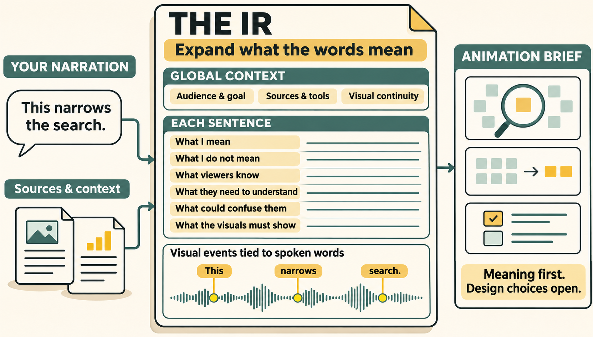

# Narration IR

**Give your animation agent the context behind every sentence.**

Narration IR is a portable skill for building an **intermediate representation
(IR)** between your narration and the visuals: a detailed explanation of what
you mean, grounded in your sources, and what the audience needs to understand.

Give your agent a script or recording and the relevant papers, code, interviews,
files or previous videos. The agent expands your words into two levels of context:
the purpose and continuity of the whole video, and the meaning of each sentence.
Your animation agent can then use that explanation to design visuals and time
their changes to the words you say.

[Install the skill](#install-the-skill) · [Read the IR format](skills/narration-ir/references/contract.md)

<picture>
  <source media="(max-width: 600px)" srcset="assets/readme/narration-to-visual-plan-mobile.png">
  
</picture>

*Illustration of the IR workflow. The waveform and storyboard sketches are
illustrative, rather than a recording or finished animation.*

The skill is a **copyable folder of instructions, examples and optional helper
scripts**. Use it in Claude Code, Codex or another agent that supports skills,
alongside your chosen animation tools such as Remotion, Manim or Motion Canvas.

## Watch the film

This workflow grew out of making [How much faster can a quantum computer be?](https://www.youtube.com/watch?v=3hZaKK0-leY),
a 27-minute Manim explanation of OpenAI’s fourth-power query-complexity result.
The [final section](https://www.youtube.com/watch?v=3hZaKK0-leY&t=1431s)
explains how the papers, narration and visuals were developed together.

[](https://www.youtube.com/watch?v=3hZaKK0-leY)

## See the difference

You say: **“This narrows the search.”**

What is being searched? What was ruled out? Have we found the answer, or just
reduced the possibilities? Which objects should remain from the previous scene?
Your source material and the surrounding explanation determine those answers.

For a hypothetical search that eliminates candidates without choosing a winner,
the sentence-level IR could contain:

| In the IR | Context for the animator |
| --- | --- |
| What I mean | The test rules out some candidates. The remaining candidates still need investigation. |
| What I do not mean | We have found or verified the winner. |
| What viewers already know | What a candidate represents and which test we just applied. |
| What they should understand next | Why the test excludes those candidates while leaving others possible. |
| What could confuse them | Highlighting a remaining candidate could look like declaring a winner. |
| What must be shown | The same candidate set before and after the test, with exclusions distinguished from remaining possibilities. |
| Timing | Tie the change in the candidate set to this occurrence of “narrows,” then hold the result. |

The full entry also cites the source passage or implementation that supports the
interpretation. The animator chooses how to show the distinction: the IR specifies
the meaning that the picture must preserve, while leaving design choices open.

The included [populated JSON sample](skills/narration-ir/examples/interview/plan.json)
and [walkthrough](skills/narration-ir/examples/interview/walkthrough.md) exercise
the same fields using a fictional interview example. Their timestamps are synthetic.

## Install the skill

With the optional [Skills CLI](https://github.com/vercel-labs/skills) (Node.js
22.20+), run this from the project where you want to use it and select your agent:

```sh
npx skills add wcook04/narration-ir --skill narration-ir
```

Or install manually without Node.js:

Clone this repository and copy **the whole `skills/narration-ir` folder** to the
skills location supported by your agent. It contains its own references, schema,
examples and helpers. It has no links back to this checkout at runtime.

```sh
git clone https://github.com/wcook04/narration-ir.git
```

For a project using Claude Code, from that project's directory:

```sh
mkdir -p .claude/skills
cp -R /path/to/narration-ir/skills/narration-ir .claude/skills/
```

For Codex, copy the same folder into `.agents/skills/` in your project or
`~/.agents/skills/` for personal use. These are the documented
[Codex locations](https://developers.openai.com/api/reference/cli); the Claude
locations are documented in [Claude Code skills](https://code.claude.com/docs/en/skills).
For another host, use its documented Agent Skills location.
If your host does not discover skills, ask it to read
`skills/narration-ir/SKILL.md` directly. Manual use needs no installer, API key,
Python environment, or renderer.

Then ask your agent:

> Use narration-ir on my recording and source folder. Keep my recorded words.
> Build a global IR for the whole video and a local IR for each sentence. Ground
> the elaboration in my sources: what I mean, what I do not mean, what viewers
> already know, what they need to understand, and what the visuals must show.
> Tie visual events to the words I say. Review the sequence so ideas are introduced
> before they are referenced, then give my animation agent the relevant IR for
> each scene. Leave the visual design choices open.

For a script that is still changing, add: “Develop the script and pictures
together; timing remains provisional until I record.”

## Try the optional tools

The skill's instructions work without Python. If you want to validate a JSON
plan or generate a brief for one scene, the helper needs Python 3.10+ and
`jsonschema`. From the repo root:

<details>
<summary>Install and run the Python helper</summary>

```sh
python3 -m venv .venv
.venv/bin/python -m pip install -r requirements.txt
.venv/bin/python skills/narration-ir/scripts/narration_ir.py validate skills/narration-ir/examples/interview/plan.json
.venv/bin/python skills/narration-ir/scripts/narration_ir.py packet skills/narration-ir/examples/interview/plan.json --beat b04
```

On Windows use `.venv\Scripts\python.exe`. The `validate` command validates the
example's structure, references and declared timing. The `packet` command prints
the brief for scene `b04`, including source excerpts, explanation and event times.

The example passes validation, with warnings that its timing is synthetic and
no audiovisual output has been reviewed. A valid plan still needs review for
meaning, readability and timing against real audio.

Import the `words` array from Whisper/WhisperX JSON with `import-whisper`; see
[the format and commands](skills/narration-ir/references/contract.md). Untimed
words are rejected. No transcription engine or renderer is bundled or installed.

</details>

## What belongs in the plan?

For the **whole video**, the agent records who it is for, the opening question,
the answer you will give, and the steps needed to explain that answer. It also
records which objects and visual conventions should stay consistent, and which
existing skills, cloned repositories, components and assets could help. Previous
videos can supply recurring objects, colours and themes when consistency matters.

For **each sentence**, the agent explains what you mean using the sources. It
records what viewers already know, what they should understand next, what they
might misunderstand, and what the picture must show. Each planned visual change
refers to a specific spoken word, so repeated words can be distinguished.

You can ask for roughly **ten words of elaboration per spoken word**: a ten-word
sentence might need a hundred words explaining its context and implications to
the animator. Ground that detail in the sources. The elaboration is background
for the agent, rather than text to display on screen. Most spoken words can
accompany the same picture without another animation.

Before animation, review the IR in order with later information hidden. Each
object and concept should be introduced before it is referenced. That review
also helps catch pictures that would reveal a conclusion too early.

With an **accepted recording**, the agent plans around the existing words and
timing. With a **draft script**, you can revise the words and pictures together,
then align the visuals after recording. Transcription timestamps are estimates
until reviewed against the audio.

## Repository map

| Location | Purpose |
| --- | --- |
| [skills/narration-ir](skills/narration-ir/SKILL.md) | Complete installable skill; copy this folder. |
| [Worked example](skills/narration-ir/examples/interview/walkthrough.md) | Eight stages, sources, populated plan and a failed treatment. |
| [References](skills/narration-ir/references/contract.md) | Portable schema, review method and renderer handoff. |
| [README illustration](assets/readme/narration-to-visual-plan.png) | Global context, sentence-level elaboration and the animation handoff. |
| [tests](tests/test_narration_ir.py) | Timing, chronology, import and isolated-copy regression tests. |
| [scripts](scripts/verify.py) | Maintainer verification and repository layout enforcement. |
| [docs](docs/provenance.md) | Design sources, limitations and release evidence. |

Run `python3 scripts/verify.py` after installing `requirements.txt` in your active
environment. [Contributing](CONTRIBUTING.md) explains the same validation route.

## Origins and license

Developed by Will Cook from a workflow for giving animation agents the context
behind recorded explanations. The public example is newly authored and fictional;
no private recordings, transcripts, conversations or project data are included.
[Design sources and adoption decisions](docs/provenance.md) distinguish this
skill from renderer-specific skills and explain what was reused.

Apache-2.0. [License](LICENSE). A copy is included in the skill folder.
